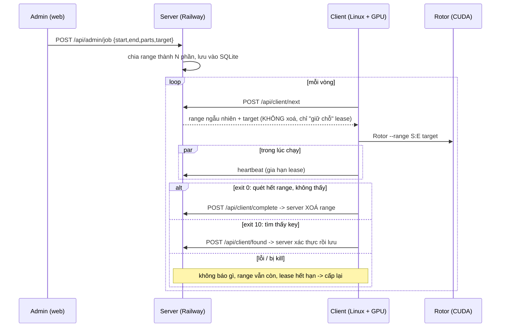

# PROJECT.md – Hệ thống chia range phân tán cho Rotor-Cuda

Tài liệu mô tả toàn bộ dự án, chia theo module để dễ sửa sau này.

```
Puzzle 3/
├── PROJECT.md                      <- file này
├── server/                         <- chạy trên Railway
│   ├── app.py                      <- API + logic chia/cấp range + lưu DB
│   ├── btc.py                      <- xác thực private key (secp256k1, hash160, base58)
│   ├── static/index.html           <- trang admin (nhập range, số phần, target; xem kết quả)
│   ├── Dockerfile, railway.json    <- deploy Railway
└── Rotor-Cuda-Distributed/         <- repo Rotor-Cuda đã sửa -> đẩy lên GitHub của bạn
    ├── Rotor-Cuda/                 <- code C++/CUDA gốc (chỉ sửa 3 file nhỏ, xem mục 5)
    ├── client/rotor_client.py      <- vòng lặp client: xin range -> chạy Rotor -> báo kết quả
    ├── client/install.sh           <- lệnh 1 dòng: cài đặt, build, chạy
    └── Others/, BinSort/, ...      <- file gốc (không dùng)
```

## 1. Luồng hoạt động



## 2. Server (`server/app.py`)

| Phần | Hàm | Chức năng |
|---|---|---|
| Config | biến ENV | `PORT`, `DATA_DIR`, `ADMIN_TOKEN`, `CLIENT_TOKEN`, `LEASE_SECONDS`, `MAX_PARTS` |
| Storage | bảng `jobs`, `ranges`, `found`, `workers`, `settings` | SQLite (WAL, synchronous=FULL) tại `DATA_DIR/ranges.db` |
| Chia range | `create_job`, `range_bounds` | Chia `[start,end]` thành N phần bằng nhau, phần cuối nhận phần dư. Không lưu sẵn từng phần (100 triệu dòng sẽ quá nặng): start/end của mỗi phần được **tính ra từ job + index**; DB chỉ lưu các phần **đã xong** (`done`) và **đang được giữ chỗ** (`leases`) |
| Cấp range | `pick_range` | Chọn ngẫu nhiên (pivot ngẫu nhiên). Ưu tiên phần chưa có lease còn hạn; nếu tất cả đang được giữ thì vẫn cấp ngẫu nhiên 1 phần (client treo không làm kẹt hệ thống) |
| API client | `h_next`, `h_heartbeat`, `h_complete`, `h_found` | xem mục 4 |
| API admin | `h_admin_create_job`, `h_admin_stop`, `h_admin_status`, `h_admin_ranges` | Bảo vệ bằng `ADMIN_TOKEN` |
| HTTP | `Handler` | Auth Bearer token (so sánh hằng thời gian), giới hạn body 64KB, không log body |

Quy tắc quan trọng (đúng yêu cầu):
- Cấp range cho client **không xoá** range. Chỉ `/complete` mới đánh dấu xong (xoá khỏi danh sách còn lại).
- Mỗi lần tạo job mới sẽ thay thế job cũ (job cũ -> `stopped`, range cũ bị xoá). Key đã tìm vẫn giữ trong bảng `found`.
- Khi tìm thấy key hợp lệ: job -> `found`, server ngừng cấp range (client nhận `idle`).
- **Server tự xác thực key**: tính address từ private key (compressed và uncompressed) và so với target. Key sai bị từ chối (HTTP 422) -> chống client giả mạo / false positive GPU.

## 3. Cấu hình & Deploy Railway

1. Đẩy thư mục `server/` lên 1 repo GitHub (hoặc `railway up` trong thư mục đó). Railway tự dùng `Dockerfile`.
2. Trong service: **Add Volume**, mount path `/data` (BẮT BUỘC, nếu không dữ liệu mất khi redeploy). Dockerfile đã đặt `DATA_DIR=/data`.
3. Variables: `ADMIN_TOKEN` (chuỗi bí mật dài), `CLIENT_TOKEN` (khuyến nghị, đưa cho các client).
4. Settings → Networking → Generate Domain → mở `https://<domain>/`, nhập `ADMIN_TOKEN`, điền: Start (hex), End (hex), số phần, target address -> "Chia range & bắt đầu".

Giới hạn: chỉ hỗ trợ địa chỉ P2PKH `1...` (Rotor mode `address` cũng chỉ hỗ trợ loại này). `MAX_PARTS` mặc định 100.000.000 (tạo job tức thì). Nếu hoàn thành hết 100 triệu phần, bảng `done` có thể nặng vài GB -> chọn Volume đủ lớn. Mỗi phần nên đủ lớn (vài phút → vài giờ GPU) để giảm số request.

## 4. API

Client (header `Authorization: Bearer <CLIENT_TOKEN>` nếu server đặt):

| Endpoint | Body | Trả về |
|---|---|---|
| `POST /api/client/next` | `{worker}` | `{status:"range", job_id, range_id, start, end, target, lease_seconds}` hoặc `{status:"idle", retry_after, reason}` |
| `POST /api/client/heartbeat` | `{job_id, range_id}` | `{ok}` |
| `POST /api/client/complete` | `{job_id, range_id, worker}` | `{ok, deleted}` (idempotent) |
| `POST /api/client/found` | `{job_id, range_id, worker, private_key}` | `{ok, verified}` hoặc 422 |

Admin (`Authorization: Bearer <ADMIN_TOKEN>`): `POST /api/admin/job`, `POST /api/admin/stop`, `GET /api/admin/status`, `GET /api/admin/ranges?limit=&offset=`. Ngoài ra `GET /health`, `GET /` (UI).

## 5. Client & thay đổi trong Rotor-Cuda

Thay đổi C++ (tối thiểu, có comment `[distributed-client]`):
- `Rotor.h`: thêm `FoundCount()`, `RangeCompleted()`, cờ `rangeCompleted`.
- `Rotor.cpp`: đặt `rangeCompleted=true` chỉ khi tiến độ > 100.5%.
- `Main.cpp`: **exit code**: `10` = tìm thấy, `0` = quét hết range không thấy, `20` = dừng sớm/lỗi. Nhờ đó client không bao giờ báo "xong" khi Rotor lỗi giữa chừng.

`client/rotor_client.py` (chỉ dùng thư viện chuẩn Python):
- `Api`: gọi server, tự retry khi mất mạng/5xx (báo key retry vô hạn).
- `build_cmd`: ghép lệnh Rotor. Gửi `end+1` để không bỏ sót key biên (chồng 1 key sang phần kế tiếp – vô hại).
- `heartbeat`: luồng gia hạn lease mỗi `lease/3`.
- Khi tìm thấy: **ghi backup cục bộ** `~/.rotor-client/FOUND_KEYS_BACKUP.txt` (chmod 600) *trước*, rồi mới báo server.
- Tuỳ chọn: `--cpu`, `--threads`, `--gpu-ids 0,1`, `--both`, `--extra "..."`, `--worker`, `--exit-when-idle`.

`client/install.sh`: tự cài gói (apt/dnf), clone/pull repo, nhận diện GPU compute capability bằng `nvidia-smi`, build **từ source** (`make gpu=1 CCAP=..`; không có CUDA thì build CPU), rồi chạy client.

**Lệnh 1 dòng trên Linux** (sau khi bạn đẩy repo lên GitHub, thay `YOUR_GITHUB_USER` ở cả URL và `REPO_URL` mặc định trong `install.sh`):

```bash
curl -fsSL https://raw.githubusercontent.com/YOUR_GITHUB_USER/Rotor-Cuda-Distributed/main/client/install.sh | bash -s -- --server https://YOUR-APP.up.railway.app --token CLIENT_TOKEN
```

Chạy nền: thêm `tmux new -s rotor` trước lệnh trên.

## 6. Kiểm tra repo gốc có "ăn cắp" key không

Đã kiểm tra (clone commit `d022792`):
- Quét toàn bộ source `Rotor-Cuda/` tìm `socket, curl, http, connect, gethostby, system(, popen, exec*, getenv, telegram, webhook...`: **không có mã mạng nào**. Chỉ `fopen` để ghi file `-o` (Found.txt), file checkpoint `.bat`, `/dev/urandom`.
- Key tìm được chỉ được `printf` ra màn hình và ghi vào file `-o` cục bộ (`Rotor::output`, `Rotor.cpp`).
- Địa chỉ `bc1qdfaj5zy...` (donate) chỉ xuất hiện trong chuỗi banner (`Bloom.cpp:86`), không dùng trong logic.
- Các file nhị phân dựng sẵn trong `Release/` (4 file `Rotor-v2-*`): `strings` không thấy URL/socket ngoài banner, nhưng **không thể kiểm chứng binary tương ứng với source** -> đã **xoá khỏi bản fork**; installer luôn build từ source.
- Lưu ý: Rotor gốc là 1 bản VanitySearch/Kangaroo (GPLv3). Giữ file `LICENSE` và công khai mã nguồn bản sửa khi đăng GitHub.
- Rủi ro còn lại (của thiết kế này, không phải của repo gốc): ai có `ADMIN_TOKEN` hoặc truy cập DB trên Railway sẽ thấy private key. Giữ token bí mật.

## 7. Đã test / chưa test

- ✅ Server + client: test end-to-end trên máy local với Rotor giả (cấp range ngẫu nhiên, xoá khi xong, từ chối key sai, nhận key đúng, auth, địa chỉ sai, lưu key).
- ✅ `btc.py`: đối chiếu key=1, key=7 (puzzle 3), WIF, RIPEMD-160 với vector chuẩn.
- ❌ **Chưa build/chạy Rotor thật** (máy phát triển là macOS, không có CUDA/Linux). Cần thử trên máy GPU Linux: `make gpu=1 CCAP=<cc>` rồi chạy 1 job nhỏ có key đã biết (ví dụ Puzzle 3 hoặc 30) để xác nhận exit code và việc Rotor kết thúc đúng khi hết range.
- `pick_range` thử ngẫu nhiên 40 lần; nếu trúng toàn phần đã xong/đang giữ (cuối job) thì đi tới phần trống kế tiếp từ điểm ngẫu nhiên.

## 8. Gợi ý sửa đổi sau này

| Muốn | Sửa ở |
|---|---|
| Thêm loại địa chỉ (P2SH, bech32, ETH) | `btc.py` (decode + verify), Rotor `-m`/`--coin` trong `build_cmd` |
| Nhiều job song song | `active_job()` / `h_next` (chọn job), UI |
| Chia range không đều, ưu tiên GPU mạnh | `range_bounds`, `create_job` |
| Đổi cách chọn ngẫu nhiên | `pick_range` |
| Đổi thời gian giữ chỗ | ENV `LEASE_SECONDS` |
| Thêm tham số Rotor | `build_cmd` hoặc `--extra` |
| Chạy dịch vụ tự khởi động | thêm unit systemd chạy `install.sh` |
| Đổi giao diện admin | `server/static/index.html` |
